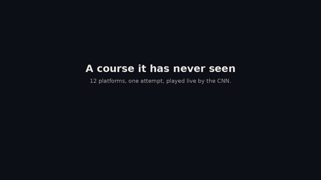
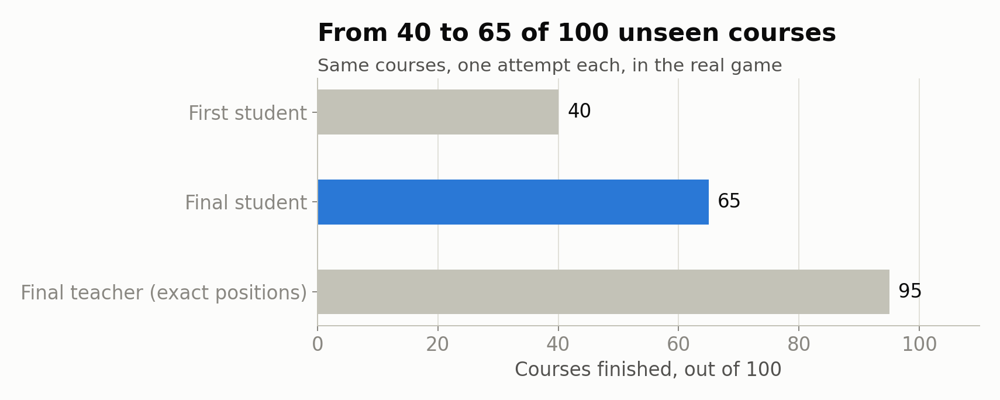
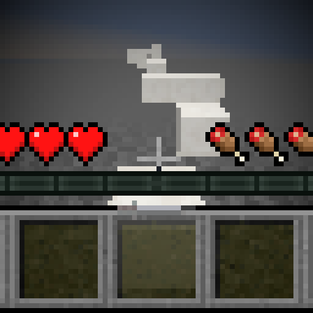
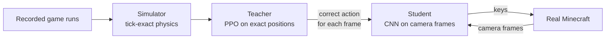
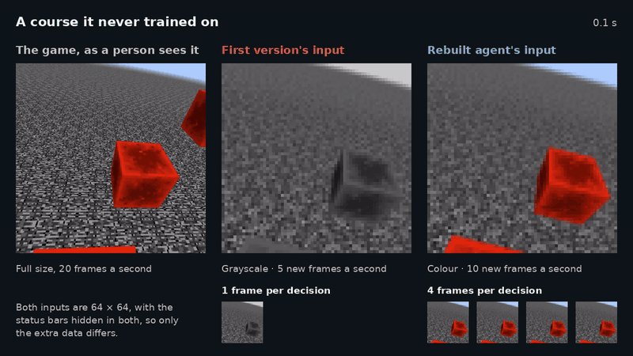
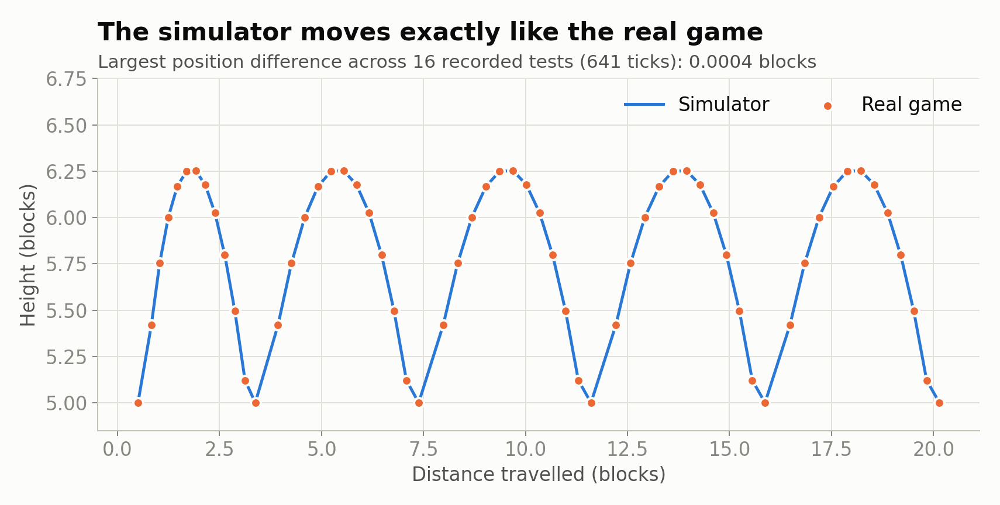
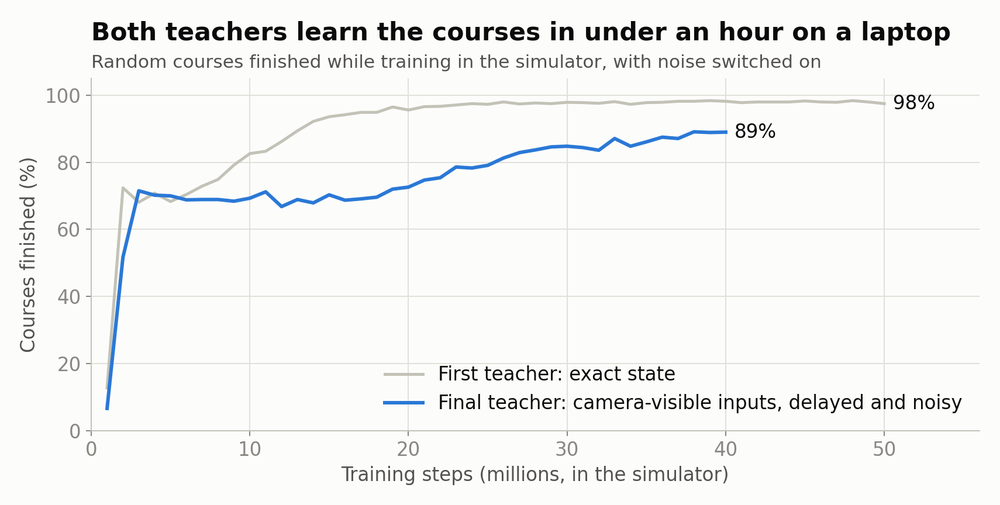
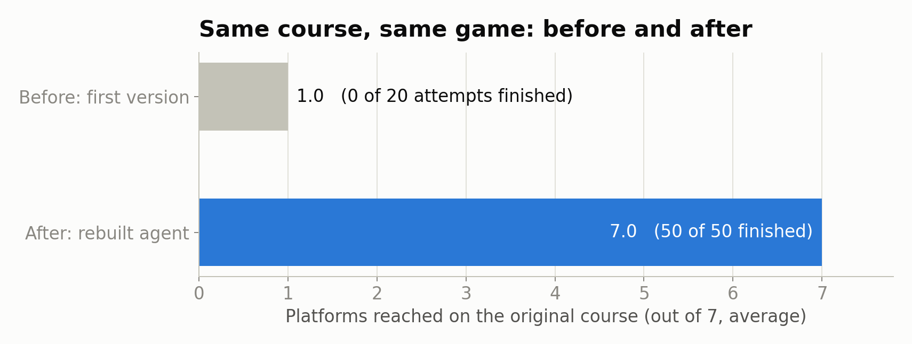

# Minecraft Parkour AI

A neural network that crosses floating-block parkour courses in real Minecraft using only the game's camera image. It gets no coordinates, no map and no game data. It looks at its last four frames and chooses forward, jump and turn ten times a second.



*The first held-out course, which it never trained on. The left side is a viewer's camera. The panel shows the agent's own view and choices. This run finished, but not every run does: the numbers are below.*

## Results

Measured in the real game (Minecraft 1.11.2), with failures included.

| Test | First version | First student | **Final student** | Final teacher |
|---|---|---|---|---|
| What it gets as input | Camera, mostly covered by the HUD | Camera only | **Camera only** | Exact positions |
| Original 8-platform course | 0 of 20 | 50 of 50 | **50 of 50** | 10 of 10 |
| 100 held-out courses | not tested | 40 of 100 | **65 of 100** | 95 of 100 |

- **Held-out courses** are random layouts of 6 to 12 platforms from the generator used in training, at full difficulty, one attempt each. None of them were used in training. "Unseen" here means unseen layouts, not new kinds of obstacle.
- **How the final model was chosen.** Checkpoints were compared on separate validation courses only. On those, the final student finished 41 of 60 and the first student 26 of 60. The held-out courses only report results.
- **The improvement is not noise.** On the same 100 held-out courses, the final student finished 33 that the first student failed, and failed 8 that the first student finished (exact McNemar test, p ≈ 0.0001).



## Why the first version failed

The first attempt was a standard recipe: a CNN trained with PPO, directly in the game. MineDojo turned Minecraft into a Python environment, and a stack of gym wrappers sat on top of it (`train_parkour.py`). Each wrapper is a thin layer that changes one thing:

| Wrapper | What it did |
|---|---|
| Actions | 5 key combinations, such as forward + jump + sprint |
| Reward | Points for getting closer to the next platform, +10 per landing, −100 for a fall, which ends the attempt |
| Action repeat | Each choice held for 4 ticks, so 5 decisions a second |
| Image | Grayscale, 64 × 64 |
| Time limit and logging | 200 decisions per attempt, results recorded |

Because it ran on a laptop without a GPU, every choice was made to keep it cheap:

| Choice | Why |
|---|---|
| Game drawn at 64 × 64, with the fastest resizing | Less for the game to draw and the network to read |
| Grayscale, one frame at a time | The smallest possible input |
| A decision every 4 ticks | Fewer network calls and training steps |
| Each attempt ends at the first fall | No time wasted falling to the floor |
| One game, one PyTorch thread | Two games fought over the same CPU cores and ran slower |

It cleared the first gap, then fell at the next one, on all 20 test attempts. The obvious guess was "not enough training", but measuring it showed three specific problems:

| Problem | Measured |
|---|---|
| Too little practice | Each restart took about 15 s, against 0.06 s for a normal step. It got about 5,300 steps in total. |
| It stopped exploring | Action entropy collapsed from 1.42 to 0.01. |
| It could barely see | The health, hunger and item bars filled most of its 64 × 64 input. |



*What the first version's network actually received, enlarged.*

The image savings were in the wrong place. Because it fell every few seconds, restarts dominated, and an average training step took about 1.5 s.

## How the rebuild works

Learning to see and learning to control at the same time is hard, and practice in the real game is slow. So the problem is split in two: an expert with perfect information learns the control problem in a fast simulator, and a vision-only student then learns to copy that expert from real game frames.



### Where the speed came from

| Change | First version | Rebuild |
|---|---|---|
| Restart after a fall | `env.reset()` rebuilds the world: about 15 s | Teleport inside the running game: 0.04 s |
| Game tick | 50 ms in normal play | About 13 ms: nothing waits for real time, so the game runs nearly 4 times faster |
| Practice | Every step in the real game, under 1 step a second | The teacher practises in a NumPy simulator running 512 courses as one set of arrays: about 20,000 steps a second |
| Environment code | A stack of gym wrappers, one game at a time | One class each for the real game (`RealGame`) and the simulator (`TeacherVecEnv`), which steps all 512 courses together and checks every tick for a fall |

A fall still ends an attempt at once, as it did before. What changed is that starting the next attempt is now almost free.

### Spending the time saved on a better view

With practice now cheap, the network can be given far more information per decision. The input stays at 64 × 64, so it still decides in about 2 ms on a CPU and the 178,518 training frames fit in about 2 GB.

| What the network gets | First version | Rebuild |
|---|---|---|
| Colour | Grayscale | Full colour |
| Frames | 1 | The last 4, so it can see motion |
| Image | Drawn at 64 × 64 | Drawn at 128, averaged down to 64 × 64 |
| Decisions | 5 a second | 10 a second |
| Status bars | Covered most of the view | Hidden |
| Feedback | Reward only | The teacher's choice for every frame |
| Numbers per decision | 4,096 | 49,152, 12 times more |



*Left: the game. Middle: the first version's input, rebuilt from the same frames, with the status bars hidden here so only the extra data differs. Right: the rebuilt agent's actual input. In grayscale the red blocks almost disappear into the floor. Made with `scripts/view_compare.py`.*

### 1. A simulator that matches the game

`parkour/sim.py` reproduces Minecraft's movement physics tick by tick in batched NumPy. Checked against 16 recorded runs from the real game (641 ticks), the largest position error is 0.0004 blocks. It runs about 20,000 steps a second, against under 1 in the first version's training loop.



### 2. A teacher that learns in the simulator

The teacher is a PPO policy (Stable-Baselines3, 512 parallel simulated runs). It sees no image, only 33 numbers:

| Part | Details |
|---|---|
| Input | For each of the next 4 platforms: distance ahead, distance to the side, height difference, width, depth and whether it exists (24). Its own velocity (3) and whether it is on the ground (1). Its last action and heading (5), set to zero in the final teacher because a camera can't see them. |
| Network | An actor that chooses the action and a critic that predicts how well the attempt will go, each 2 layers of 256 units, about 150,000 weights in total. PPO uses the critic's prediction to judge whether an action turned out better or worse than expected. |
| Output, every 0.1 s | Forward (yes or no), jump (yes or no) and turn: one of 7 rates from 20° left to 20° right |
| Reward | +1 for each new platform, +2 for finishing, −1 for a fall (which ends the attempt), −0.002 per step |
| Training | 65,536 steps per update. Courses get harder as it improves. The final teacher also gets delays of up to 2 ticks, noisy inputs and a penalty for jerky turns. |

The final teacher trained for 40 million steps in 48 minutes on a laptop CPU.



### 3. A student that learns from real frames

The student is a CNN of about 1 million weights that takes four stacked 64 × 64 RGB frames and takes about 2 ms per decision on a CPU. It has four convolution layers (32, 64, 64 and 128 filters), each halving the image, then two ordinary layers of 384 and 256 units. It has three action outputs (forward, jump, turn) and a helper output that predicts 28 of the teacher's numbers (platform positions, its speed, whether it is on the ground), which pushes it to learn what to look for.

It trains with [DAgger](https://arxiv.org/abs/1011.0686): the student plays the real game while the teacher labels the correct action for every frame, so the student also learns how to recover from its own mistakes. The final dataset has 178,518 real game frames. Restarts use a teleport inside the running game, which takes 0.04 s rather than 15 s.

## When the student stalled, the data showed why

The first student stopped improving on new courses, so every jump was logged and analysed:

- **Drops were hard.** On a 50-course diagnostic set, jumps down a level landed 57% of the time, against 94% for level jumps.
- **The expert was twitchy.** Given information just one decision (0.1 s) old, the first teacher's success fell from 99% to 2.4%. It relied on full-speed 20° turns 38% of the time, and a jerky expert is very hard to copy from images.

The fix was a better teacher. The final teacher gets only inputs a camera could reveal, is trained with random observation delay and noise, and is penalised for jerky steering. Its full-speed turns fell from 38% to 7.7%. The student was then retrained against it, with left-right mirrored images and extra practice on drops.

Results on the same 100 held-out courses:

| Landing rate per jump | First student | Final student | Final teacher |
|---|---|---|---|
| Level | 92% | 96% | 99% |
| Up a level | 86% | 95% | 99% |
| Down a level | 73% | 88% | 100% |
| **Courses finished** | **40** | **65** | **95** |



## What it can't do yet

- **It still falls on about a third of new layouts.** With 100 courses, the 95% margin on 65 is about ±9 points. On a separate 50-course diagnostic set it finished 54%, and on the 60 validation courses (used to choose the checkpoint, so slightly flattering) 68%.
- **Steering is its weakest skill.** On the diagnostic set, 14 of its 27 missed jumps went sideways, 7 went long, 4 fell short and 2 walked off an edge.
- **More data had stopped helping.** Playing alone, its score was flat from about 120,000 to 178,000 frames, so the next gains need better perception rather than more of the same data.
- **Its vision is tied to the block textures it trained on.** The same 40 fresh courses, run once per block type:

| Block | Trained on it? | Courses finished |
|---|---|---|
| Quartz | Yes | 32 of 40 |
| Oak planks | No | 21 of 40 |
| Purpur | No | 17 of 40 |
| Brick | No | 14 of 40 |
| Obsidian | No | 0 of 40 |

The next steps are higher-resolution input for steadier aim, varied textures and lighting in training, and new kinds of obstacle.

## Run it

MineDojo needs old dependencies, so this takes some care. The working setup was Python 3.10 and Java 8 on Ubuntu 24.04 with:

- `minedojo==0.1`, `gym==0.21.0`, `stable-baselines3==1.8.0`, `numpy==1.26.4`, CPU `torch`, `opencv-python`, `imageio`, `imageio-ffmpeg`, `tensorboard`, `rich`
- `pip==24.0`, `setuptools==65.5.0` and `wheel==0.38.4` while installing gym, with `--no-build-isolation`
- MineDojo's bundled `build.gradle` pointed at `org.spongepowered:mixingradle:0.6-SNAPSHOT` from the SpongePowered Maven repository, because the JitPack commit it uses by default no longer resolves
- `patches/malmo_hud_and_third_person.patch` applied with `patch -p0` from MineDojo's `sim/Malmo/Minecraft/src/main/java` directory, which adds the switches for HUD-free frames and the third-person video view

Re-run the held-out test with the included models, from the repository root:

```bash
MINEDOJO_HEADLESS=1 MINEDOJO_HIDE_GUI=1 python -u scripts/evaluate.py --student models/student_final.pt --teacher models/teacher_final.zip --camera-only-teacher --courses 100 --zigzag 50 --out runs/evaluation_repeat.json
```

The full pipeline, in order (set the same two environment variables for anything that opens the game):

```bash
python -u scripts/capture_physics.py    # record real movement
python -u scripts/validate_sim.py       # compare the simulator with it
python -u scripts/train_teacher.py --out runs/teacher2 --steps 40000000 --max-delay 2 --camera-only --smooth 0.02 --obs-noise 0.05 --threads 2 --seed 21
python -u scripts/train_student.py --teacher runs/teacher2/teacher_final.zip --camera-only-teacher --out runs/student2 --mirror --beta-start 0.5 --beta-decay 0.8 --pretrain-steps 3000 --aux-coef 5 --weighted-loss --vertical-mix 0.5 --episodes-per-round 60 --steps-factor 2 --hours 4 --seed 23
python -u scripts/polish_student.py --dir runs/student2 --steps 15000 --mirror --weighted-loss --aux-coef 5
bash scripts/final_stage.sh runs/student2 v2 runs/teacher2/teacher_final.zip --camera-only-teacher
```

The final student was started from the first student's weights (`--warm-start`) and reused 92,333 of its frames, relabelled by the new teacher with `scripts/relabel_store.py`. Course seeds are 555111 for validation and 987654 for the held-out test.

## Repository layout

```
parkour/            sim.py          tick-exact batched physics
                    courses.py      the original course and the generator
                    features.py     teacher observation and action definition
                    teacher_env.py  vectorised simulator environment for PPO
                    real_env.py     client for the real game
                    student.py      CNN, frame stack, DAgger dataset, losses
scripts/            training, evaluation, failure analysis, demo video and charts
models/             the final student and teacher
patches/            the Malmo changes this project needs
media/              charts and the GIF above
train_parkour.py    the first version, kept for comparison
watch_parkour.py    records the first version
```

## Built with

[MineDojo](https://github.com/MineDojo/MineDojo) and [Malmo](https://github.com/microsoft/malmo) for the game interface, [Stable-Baselines3](https://github.com/DLR-RM/stable-baselines3) for PPO, PyTorch and NumPy. Everything was trained on a laptop without a GPU, in under a day.
